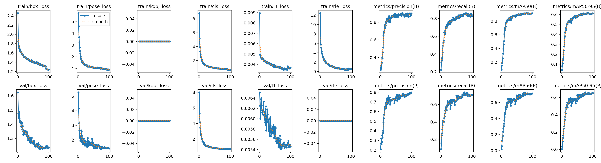
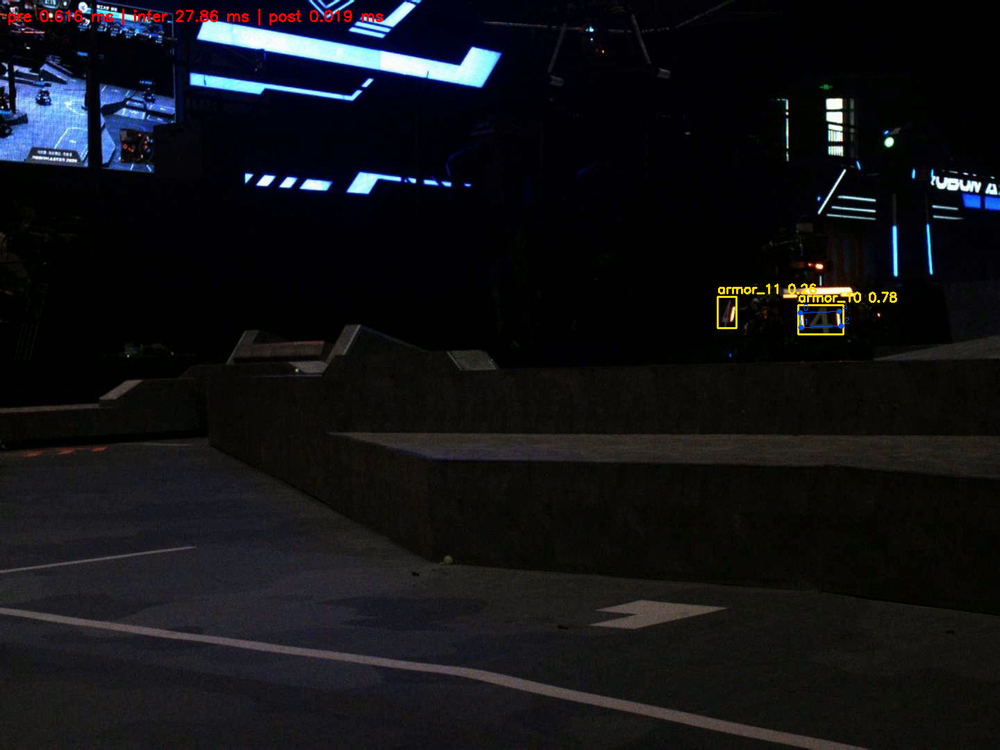

# 考核一：YOLO26 装甲板角点识别与 OpenVINO 部署

本项目使用 YOLO26n-Pose 预测装甲板类别、检测框和四个角点，在 Colab 完成训练后导出 ONNX，通过题目指定的 C++ OpenVINO 示例库部署，对测试视频逐帧推理并可视化。本目录保存训练 notebook、100 轮训练记录、最终模型及视频静态抽帧结果。

## 1. 考核要求与实现对应

依据 [暑假考核 PDF](../00_题目原件/暑假考核.pdf) 第 1–2 页，神经网络题目要求识别装甲板角点并可视化，使用 YOLO26 训练 Pose 模型、导出 ONNX、使用指定推理与可视化代码完成部署。题目允许按照官方文档和默认参数训练，没有规定最低 mAP 或 FPS。通用要求包括 Git 管理代码，以及 README 中的环境、编译和运行说明。

| 要求 | 对应材料 |
| --- | --- |
| YOLO26 Pose 训练 | [`yolo26_pose.ipynb`](yolo_pose/yolo26_pose.ipynb)：1 轮 smoke test 与 100 轮正式训练 |
| ONNX 导出 | [`best.pt`](yolo_pose/final_model/best.pt)、[`best.onnx`](yolo_pose/final_model/best.onnx)，notebook 保留导出代码和日志 |
| 指定代码部署 | [`C++ OpenVINO 推理库`](yolo_pose/YOLO_Pose_OpenVINO_C_Inference/README.md) |
| 测试视频可视化 | [`results/README.md`](results/README.md) 的运行统计及 `openvino_frames/` 中的 6 张图片 |

推理代码来源为题目提供的 [YOLO_Pose_OpenVINO_C_Inference 示例仓库](https://gitee.com/slime0rimiru0/YOLO_Pose_OpenVINO_C_Inference)。本地视频示例增加无窗口运行、静态抽帧与统计功能，并使用训练配置的 `armor_0` 至 `armor_12` 显示类别。上游下载内容未附 LICENSE，来源说明见推理库 README。

## 2. 树状文件结构

```text
01_神经网络/
├── README.md                           # 考核说明、技术分析和指标解读
├── results/
│   ├── README.md                       # 视频统计和模型 SHA-256
│   └── openvino_frames/
│       ├── frame_000001.png
│       ├── frame_000400.png
│       ├── frame_000800.png
│       ├── frame_001200.png
│       ├── frame_001600.png
│       └── frame_002000.png             # 框、类别、角点、连线及耗时
└── yolo_pose/
    ├── yolo26_pose.ipynb                # 数据配置、训练、验证、导出和预测
    ├── final_model/
    │   ├── best.pt                     # 最佳 PyTorch 权重
    │   └── best.onnx                   # OpenVINO 部署模型
    ├── yolo26n-full/
    │   ├── args.yaml                   # 正式训练配置
    │   ├── results.csv                 # 100 轮损失、指标及学习率
    │   ├── results.png                 # 训练与验证曲线
    │   ├── labels.jpg                  # 类别与框位置、尺寸分布
    │   ├── Box{P,R,F1,PR}_curve.png     # 文件组：检测框曲线
    │   ├── Pose{P,R,F1,PR}_curve.png    # 文件组：角点曲线
    │   ├── confusion_matrix.png
    │   ├── confusion_matrix_normalized.png
    │   ├── train_batch{0,1,2}.jpg       # 文件组：训练初期样本
    │   ├── train_batch{23760,23761,23762}.jpg
    │   ├── val_batch{0,1,2}_labels.jpg  # 文件组：验证标注
    │   └── val_batch{0,1,2}_pred.jpg    # 文件组：验证预测
    └── YOLO_Pose_OpenVINO_C_Inference/
        ├── CMakeLists.txt              # C++17、OpenVINO、OpenCV 构建
        ├── README.md                  # 详细接口和构建说明
        ├── include/qd/yolo_pose.hpp    # 配置、检测结果和耗时接口
        ├── src/yolo_pose_openvino.cpp  # 预处理、推理、后处理和绘制
        └── example/
            ├── example.cpp            # 视频程序 yolo_pose_demo
            └── minimal_example.cpp    # 单图调用示例
```

花括号表示多个已有文件的归组，不是实际文件名。原始数据集和测试视频不在本目录；视频附件清单与放置路径见 [`RELEASE_ASSETS.md`](../RELEASE_ASSETS.md)。该清单尚未提供实际 Release 下载链接，复现前需要取得题目附件。

## 3. 技术分析

### 3.1 数据与模型

notebook 使用 `XJTLU_2023_Keypoints_ALL` 的既有划分：训练集 4224 张，验证集 2508 张，验证集共有 3225 个装甲板实例。配置定义 13 类 `armor_0` 至 `armor_12`，关键点形状为 `kpt_shape: [4, 2]`，即每个目标四组 `(x, y)`，没有独立的关键点可见性标注。类别名是编号占位，现有配置不足以将其解释成具体阵营或机器人编号。

训练从 `yolo26n-pose.pt` 预训练权重开始，适配为 13 类、4 个二维关键点。日志中的网络包含 Conv、C3k2、SPPF、C2PSA，通过上采样和拼接融合多尺度特征，三层特征送入 Pose26 输出头，同时预测框、类别和角点。训练结构为 363 层、2,707,518 个参数、6.4 GFLOPs；融合后的导出结构记录为 129 层、2,449,299 个参数、5.6 GFLOPs。两组数字对应不同处理阶段。

nano 规模有利于降低部署计算量。检测框负责找到目标区域，角点为后续 PnP 提供几何约束，所以框检测成功并不保证角点准确；用于 PnP 时还需核对关键点索引与物理角点的对应顺序。

### 3.2 训练配置

| 项目 | 记录 |
| --- | --- |
| 环境 | Colab，Tesla T4（约 15 GB 显存），Python 3.13.15，PyTorch 2.11.0+cu130，Ultralytics 8.4.174 |
| 正式训练 | 100 epochs，`imgsz=640`，`batch=16`，`device=0`，`workers=2` |
| 优化器 | `optimizer=auto` 实际选择 AdamW，初始学习率 0.000588，momentum 0.9 |
| 其他设置 | weight decay 0.0005，warmup 3 轮，AMP 开启，seed 0，deterministic 开启 |
| 增强配置 | HSV、translate 0.1、scale 0.5、fliplr 0.5、mosaic 1.0；最后 10 轮关闭 Mosaic |
| 归档 | 每 10 轮保存权重、生成训练图表；正式训练约 3.781 小时 |

完整参数见 [`args.yaml`](yolo_pose/yolo26n-full/args.yaml)。其中 `lr0=0.01` 是配置字段，日志明确说明 auto 模式忽略该值，因此实际初始学习率应以 0.000588 为准。1 轮 smoke test 用于检查链路，正式训练重新加载预训练模型，并非续训 smoke test。

数据配置中的 `flip_idx: [0, 1, 2, 3]` 表示水平翻转时不交换角点索引。它是否符合标注的角点语义，需要结合原始标注核对；当前目录未附原始标注，不能仅根据训练指标确认该设置正确。

### 3.3 ONNX 与 OpenVINO 数据流

导出参数为 `format="onnx"`、`imgsz=640`、`opset=12`、`simplify=True`、`dynamic=False`、`nms=True`、`device="cpu"`。notebook 导出日志记录固定输入 `[1,3,640,640]`、输出 `[1,300,14]`。每个候选包含：

```text
x1, y1, x2, y2, score, class_id,
k0_x, k0_y, k1_x, k1_y, k2_x, k2_y, k3_x, k3_y
```

```text
视频 BGR 帧 → letterbox 缩放与居中填充 → RGB / float32 / 除以 255 / NCHW
           → OpenVINO 模型调用 → 置信度过滤与坐标还原 → C++ NMS
           → 绘制框、类别和角点 → 窗口显示或 PNG 抽帧
```

预处理将图像等比例缩放后放入 640×640 画布，填充值为 `(114,114,114)`；OpenVINO 预处理图完成颜色、类型、归一化和布局转换。后处理减去 padding，再除以缩放比例，将框和关键点还原至原图坐标。

本地后处理支持端到端输出，读出类别和角点后仍进行一次框 IoU NMS，且该 C++ NMS 不区分类别。默认检测置信度为 0.25，NMS IoU 为 0.45，关键点显示阈值为 0.5。该输出没有独立角点置信度，代码用目标 `score` 填入各角点 `confidence`，所以显示阈值控制整组角点是否绘制，不能反映单个角点可信度。

Python 视频推理结果可下载：[armors_yolo_test.avi](https://github.com/Headhunterz01/2026-vision-assessment/releases/tag/Video/armors_yolo_test.avi)。本机副本位于本目录。

## 4. 结果指标解析

### 4.1 最佳权重复验

以下使用 notebook 单独调用 `best.pt` 的 `model.val(...)` 输出，验证规模为 2508 张图像、3225 个实例。日志保留三位小数，百分数相应保留一位。这是 PyTorch 验证集精度，不是 ONNX/OpenVINO 精度测量。

| 指标 | Box：检测框 | Pose：四角点 |
| --- | ---: | ---: |
| Precision | 88.6% | 77.7% |
| Recall | 85.5% | 74.2% |
| mAP50 | 91.3% | 72.9% |
| mAP50-95 | 60.8% | 66.0% |

- **Precision**：`TP/(TP+FP)`，衡量预测中正确匹配的比例，反映误报情况。
- **Recall**：`TP/(TP+FN)`，衡量真实目标被正确检出的比例，反映漏检情况。
- **Box mAP**：通过框 IoU 判断匹配。mAP50 使用 IoU 0.50；mAP50-95 汇总 0.50 至 0.95、步长 0.05 的 AP，并对类别取平均。
- **Pose mAP**：通过 OKS（考虑角点误差和目标尺度等因素的关键点相似度）判断匹配，50 和 50-95 对应 OKS 阈值。该指标不是角点像素误差，也不是 PnP 姿态误差。
- **F1**：`2PR/(P+R)`，衡量阈值下精确率与召回率的折中，应结合对应 F1 曲线选阈值。

Box mAP50 与 mAP50-95 相差约 30.5 个百分点，说明宽松匹配下多数目标可以找到，但严格框定位仍有提升空间。Pose 的精确率和召回率低于 Box，角点识别更困难。Box 和 Pose 使用不同匹配标准，不能根据 Pose mAP50-95 更高就认定角点定位优于框定位。

### 4.2 各类别表现

下表同样来自最佳权重单独复验。Instances 是验证实例数；一张图可包含多个类别，逐类 Images 数不能直接相加作为图像总数。

| 类别 | Instances | Box AP50 | Pose AP50 | Pose AP50-95 |
| --- | ---: | ---: | ---: | ---: |
| armor_0 | 313 | 92.0% | 60.7% | 57.9% |
| armor_1 | 362 | 93.0% | 89.0% | 85.9% |
| armor_2 | 246 | 86.5% | 67.9% | 57.7% |
| armor_3 | 454 | 91.7% | 73.0% | 66.4% |
| armor_4 | 248 | 88.5% | 71.6% | 64.5% |
| armor_5 | 70 | 96.9% | 67.2% | 66.6% |
| armor_6 | 未出现在逐类验证表 | — | — | — |
| armor_7 | 225 | 86.7% | 78.5% | 74.2% |
| armor_8 | 354 | 92.5% | 87.4% | 72.0% |
| armor_9 | 196 | 89.7% | 88.2% | 86.9% |
| armor_10 | 335 | 88.9% | 79.0% | 68.2% |
| armor_11 | 283 | 92.0% | 40.5% | 29.6% |
| armor_12 | 139 | 97.1% | 71.8% | 62.4% |

`armor_11` 的框 AP50 为 92.0%，但 Pose AP50-95 只有 29.6%，应优先检查角点标注顺序、遮挡及预测偏移，现有结果不能确定具体原因。`armor_1`、`armor_9` 的角点表现较好；`armor_5` 仅 70 个实例，结果更易受样本组成影响。配置有 13 类，逐类日志和 PR 曲线只列出 12 类，因此现有评估无法说明 `armor_6` 的泛化能力。

### 4.3 收敛与最佳轮次

[`results.csv`](yolo_pose/yolo26n-full/results.csv) 中的正式训练记录如下：

| 指标 | 第 1 轮 | 第 100 轮 |
| --- | ---: | ---: |
| train/box_loss | 2.45704 | 1.24318 |
| train/pose_loss | 5.70045 | 0.92287 |
| train/cls_loss | 8.82593 | 0.66303 |
| val/box_loss | 1.62447 | 1.23432 |
| val/pose_loss | 5.25093 | 1.42061 |
| Box mAP50-95 | 4.349% | 61.157% |
| Pose mAP50-95 | 0.330% | 65.064% |

损失下降、验证指标上升，说明模型已学习到检测与角点定位能力。末轮训练 Pose loss 低于验证 Pose loss，存在泛化差距，但不能仅凭这一差距判定严重过拟合。`train/kobj_loss` 一直为 0 与二维关键点配置相符，不应据此认定模型完美预测了角点可见性。

Box mAP50-95 峰值为第 86 轮的 61.296%，Pose 峰值为第 76 轮的 65.895%。两者不属于同一轮，不能拼成同一个模型的成绩。`best.pt` 由训练器按验证适应度选出，复验成绩不等于第 100 轮成绩。训练结束自动验证的 Pose mAP50/mAP50-95 为 72.7%/65.9%，与单独复验 72.9%/66.0% 略有差异，应分别保留口径。

### 4.4 图表阅读

| 图表 | 用途 |
| --- | --- |
| [`results.png`](yolo_pose/yolo26n-full/results.png) | 联合观察损失和验证指标是否趋于稳定 |
| [`BoxPR_curve.png`](yolo_pose/yolo26n-full/BoxPR_curve.png)、[`PosePR_curve.png`](yolo_pose/yolo26n-full/PosePR_curve.png) | 对比类别 AP 和精确率/召回率折中；归档 Pose 图总体 mAP50 为 0.727，对应训练结束自动验证 |
| Box/Pose P、R、F1 曲线 | 查看阈值变化对误检、漏检与 F1 的影响，部署默认阈值不等于最优阈值 |
| [`归一化混淆矩阵`](yolo_pose/yolo26n-full/confusion_matrix_normalized.png) | 检查类别混淆和背景相关错误，不能代替角点误差评估 |
| `val_batch*_labels.jpg` 与 `val_batch*_pred.jpg` | 对照同批次标注与预测，检查角点偏移、错序、漏检与误检 |



### 4.5 OpenVINO 视频结果

以下来自已归档的 [`results/README.md`](results/README.md)，本次文档整理未重新训练或运行视频推理。

| 项目 | 已记录结果 | 指标含义 |
| --- | ---: | --- |
| 运行设备 | CPU | 未记录具体 CPU 型号，不能作为跨设备基准 |
| 视频参数 | 1440×1080，30 FPS | `armors_yolo_test.mp4` |
| 实际处理帧数 | 2055 | 按解码循环实际返回帧数统计 |
| 有检测帧数 | 1998 | 约 97.23% 的帧有至少一个检测，不是 Recall |
| 检测总数 | 5127 | 跨帧累计检测次数，不是独立目标数或正确检测数 |
| 平均模型调用耗时 | 29.9155 ms/帧 | 不含 C++ 显式 letterbox、后处理、解码、绘制和存图；图内 OpenVINO 预处理属于模型调用 |
| 耗时倒数 | 约 33.43 次/秒 | `1000/29.9155`，不是实测端到端 FPS |

视频元数据报告 2061 帧，但记录说明 C++/Python OpenCV 解码循环均读到 2055 帧，故统计以实际处理数为准，现有材料未确认差异根因。模型调用耗时接近 30 FPS 的 33.33 ms 帧间隔，加入其余开销后是否实时仍需端到端测量。测试视频未附逐帧真值，不能计算视频 mAP、Precision、Recall 或角点像素误差。

部署模型 SHA-256：`b6c20fa44427ef5f0dae115cf0f0ca13a26589a7983e12cab1785041711b5444`。



其他图片见 [`openvino_frames/`](results/openvino_frames/)。本目录归档静态抽帧；notebook 还保留历史 Python 视频预测与 AVI 保存代码，不能将历史输出混作 C++ 部署结果。

## 5. 环境、编译和运行

### 5.1 训练复现

在 Colab 打开 [`yolo26_pose.ipynb`](yolo_pose/yolo26_pose.ipynb)，将数据包放到 Google Drive 的 `MyDrive/armor_exam/armors_datasets.tar.gz`，挂载 Drive、解压并生成 `armor_pose.yaml`。检查数据路径 `/content/dataset/XJTLU_2023_Keypoints_ALL`，依次运行 smoke test、正式训练、最佳模型验证及 ONNX 导出单元。

notebook 使用 `pip install -U ultralytics`，复现时可固定 `ultralytics==8.4.174` 并参考上方记录的 Python/PyTorch 环境。Colab 重启后临时路径会丢失，需恢复 Drive 备份权重或修改模型路径。最终将 `best.pt` 和 `best.onnx` 保存到 `yolo_pose/final_model/`。

### 5.2 C++ 构建

以下命令面向 Ubuntu/Linux，从**资料根目录**执行。Windows 原生构建需另行准备 C++17 编译器、OpenCV 开发库和 CMake 包路径，以下 bash 命令不能直接当作 PowerShell 命令执行。

依赖为 CMake 3.16+、C++17 编译器、OpenCV 开发库及 OpenVINO Runtime。Python wheel 提供 OpenVINO CMake 配置、头文件和运行库，详细环境说明见 [`python_env/README.md`](../python_env/README.md)。

```bash
sudo apt install -y build-essential cmake libopencv-dev python3-venv
python3 -m venv python_env/.venv
python_env/.venv/bin/python -m pip install -r python_env/requirements.txt

OV_CMAKE_DIR="$(python_env/.venv/bin/python -c 'from openvino.utils import get_cmake_path; print(get_cmake_path())')"
cmake -S 01_神经网络/yolo_pose/YOLO_Pose_OpenVINO_C_Inference \
  -B 01_神经网络/yolo_pose/YOLO_Pose_OpenVINO_C_Inference/build \
  -DOpenVINO_DIR="$OV_CMAKE_DIR"
cmake --build 01_神经网络/yolo_pose/YOLO_Pose_OpenVINO_C_Inference/build -j"$(nproc)"
```

### 5.3 测试视频运行

将题目视频放到 `00_题目原件/videos/armors_yolo_test.mp4`，运行：

```bash
01_神经网络/yolo_pose/YOLO_Pose_OpenVINO_C_Inference/build/yolo_pose_demo \
  --model 01_神经网络/yolo_pose/final_model/best.onnx \
  --video 00_题目原件/videos/armors_yolo_test.mp4 \
  --device CPU --input-size 640 \
  --conf 0.25 --iou 0.45 --kpt-conf 0.5 \
  --headless --save-dir 01_神经网络/results/openvino_frames --save-every 400
```

程序推理所有可解码帧，仅第 1 帧和每 400 帧保存 PNG，间隔不影响推理帧数；该间隔与已有 6 张图片编号一致。去掉 `--headless` 可显示窗口，按 `q` 或 `Esc` 提前退出；加入 `--debug` 查看每帧前处理、模型调用及后处理耗时。结束后终端汇总总帧数、有检测帧数、检测总数和平均模型调用耗时。

## 6. 结论与改进方向

现有材料覆盖 YOLO26 Pose 训练、ONNX 导出、指定代码部署和视频可视化流程。验证集表明目标检测已较稳定，角点精度仍有类别差异，尤其需要检查 `armor_11`。后续可核对角点顺序和水平翻转索引、补充 `armor_6` 的验证覆盖，并测量角点像素误差、PyTorch 与 ONNX/OpenVINO 输出一致性及端到端耗时。这些是后续验证方向，当前归档未提供相应结果。
